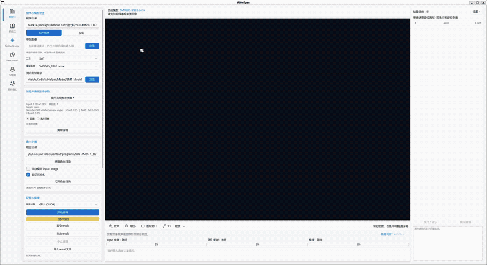
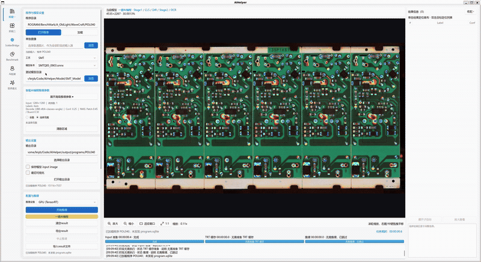
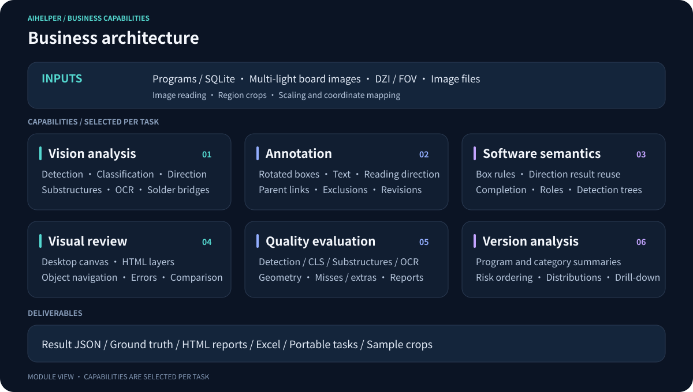
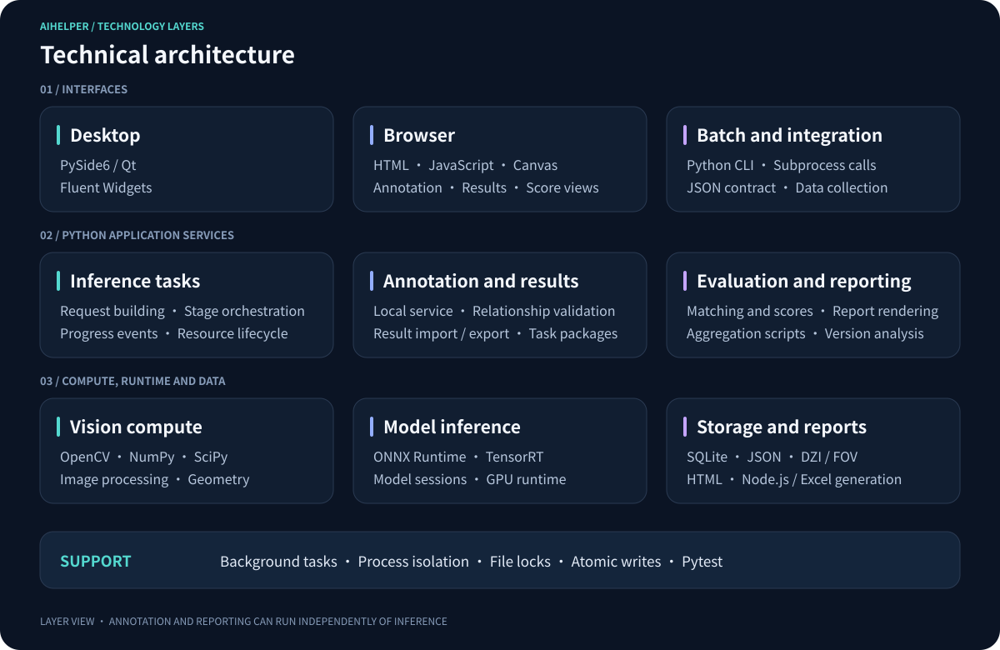

# AIHelper

### A PCB/AOI vision development and evaluation workbench

Multi-model detection · Browser annotation · Interactive visualization · Scoring and version analysis

[Demos](#product-demos) · [Features](#what-you-can-do) · [Business architecture](#business-architecture) · [Technical architecture](#technical-architecture) · [中文](README.md)

> This repository showcases AIHelper's capabilities and design. Source code, models, and production data remain private.

AIHelper connects image input, multiple vision models, human review, and quality reporting for PCB automated optical inspection (AOI) development, testing, and annotation.

## Product demos

These animations show detection results from two different manufacturing processes. Click either animation to view it at its original size.

<table>
  <thead>
    <tr>
      <th align="left" width="50%">01 · Process results</th>
      <th align="left" width="50%">02 · Process results</th>
    </tr>
  </thead>
  <tbody>
    <tr>
      <td></td>
      <td></td>
    </tr>
    <tr>
      <td align="center">Detection overlays · Component results</td>
      <td align="center">Board results · Local detail inspection</td>
    </tr>
  </tbody>
</table>

## What you can do

### Run detection and inspect each component

Zoom from the full board to an individual component to inspect boxes, categories, internal structures, and recognized text. Run a particular stage or selected region as needed, or process multiple programs in a batch.

The desktop also lets you inspect software-generated detection boxes and compare synchronized views before and after box completion.

### Annotate in the browser

Draw and adjust rotated boxes for components, leads, pads, and text. Use multiple selection, copy and paste, undo, and component navigation. OCR annotations also capture text and reading direction.

The editor saves ground truth through a local service. Portable tasks can be handed to another Windows computer for continued annotation.

### Find problems on the image

Interactive HTML views overlay predictions and human annotations. Filter missed detections, false positives, classification errors, or box positioning issues, then navigate directly to the relevant component.

Detection, classification, and text recognition are evaluated separately, helping distinguish a missed object from an incorrect category, misplaced box, or transcription error.

### Compare versions with quality reports

Aggregate scores across programs into **HTML dashboards and Excel reports**. Compare versions, programs, and component categories.

Development reports prioritize issues, show position, size, and angle error distributions, and link back to individual program reports for image inspection.

[Explore aggregate scoring and its companion tools (中文)](docs/features.md#5-综合评分版本对比与开发诊断)

## Business architecture

**Evaluation flow:** model results + human ground truth → stage scores → program and version summaries. People maintain annotations; scoring and aggregation read existing data.

## Technical architecture

| Layer | Technologies and implementation |
| :--- | :--- |
| Desktop | Python · PySide6 / Qt · Fluent Widgets |
| Browser tools | HTML · JavaScript · Canvas · Local annotation service |
| Vision and inference | OpenCV · NumPy · SciPy · ONNX Runtime · TensorRT |
| Data and reports | SQLite · JSON · DZI / FOV · HTML reports · Node.js / Excel generation |
| Tasks and validation | Background tasks · Process isolation · File locks and atomic writes · Pytest |

[Architecture details (中文)](docs/architecture.md) · [Engineering (中文)](docs/engineering.md)

## Supporting tools and deliverables

| Module | Artifacts and interfaces |
| :--- | :--- |
| Aggregate scoring | `综合评分.py` · Version dashboards · Development diagnostics · Excel workbooks |
| Portable annotation | `.aitask` packages · Windows annotation runtime · GT export |
| Data collection | Board and image inference interfaces · JSON results · Subprocess client |
| Sample preparation | Image batches with resume · DIP crops grouped by category |
| Standalone algorithms | Regional OCR · Solder-bridge detection / segmentation · C ABI and C++ / C# integration reference |

[Full feature catalog (中文)](docs/features.md) · [Project story (中文)](docs/project-story.md)
