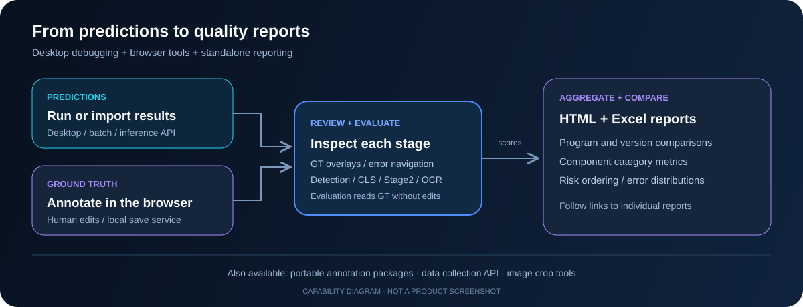
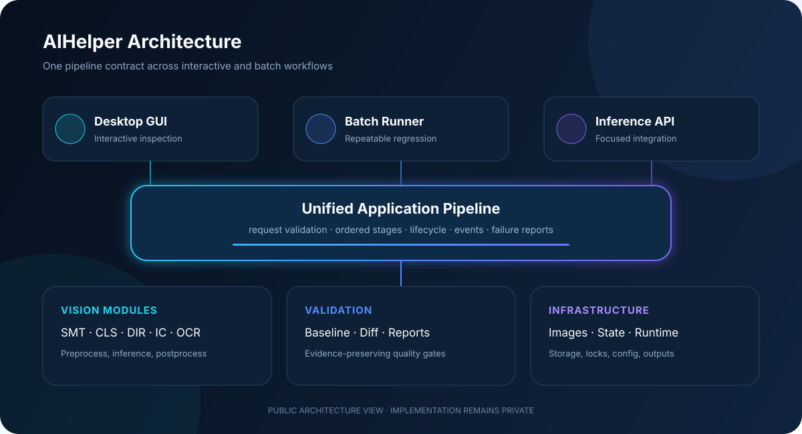
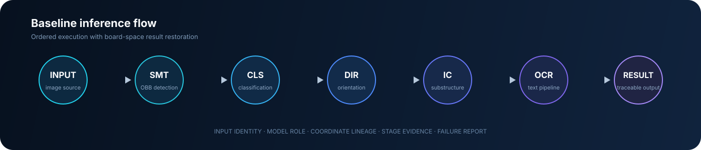

<div align="center">


# AIHelper

### PCB/AOI 视觉算法开发与评测工作台

从模型推理到浏览器标注、交互式可视化、质量评分与版本比较，<br>
让算法结果可查看、可复核、可量化，也能交付给标注与数据采集流程。

<p>
  
  
  
  
</p>

[功能全景](docs/features.md) · [标注与可视化](#浏览器标注与结果可视化) · [评分与版本比较](#评分报告与版本比较) · [产品演示](#产品演示) · [English](README.en.md)

</div>

> [!IMPORTANT]
> 这是 AIHelper 的公开项目展示仓库。业务源码、模型权重、生产数据和内部配置均保留在私有仓库中；这里仅展示经过整理的产品能力、架构思路与工程实践。

## 项目概览

AIHelper 面向 PCB/AOI 算法开发、测试、标注与数据采集场景。桌面工作台用于运行和调试模型，浏览器工具用于维护标准答案、复核预测与查看评分，独立汇总脚本用于比较版本、定位问题并生成 HTML 和 Excel 报告。

| 功能方向 | 可以完成的工作 |
| :--- | :--- |
| 推理与调试 | 多阶段检测、分类、方向校正、子结构与 OCR；整板、区域及独立算法调试 |
| HTML 标注 | 旋转框编辑、一级与二级父子关联、OCR 文本与阅读方向、评测排除区 |
| HTML 可视化 | 多图层结果查看、GT 与预测对照、漏检／误检／分类错误定位 |
| 质量评分 | 检测、分类、子结构和 OCR 独立评价，分析中心、尺寸、角度与覆盖质量 |
| 版本比较 | 多程序汇总、版本差值、元件类别指标、风险排序、HTML 驾驶舱与 Excel |
| 数据交付 | 便携标注包、Result v2、无界面推理接口、图片批处理与分类裁图 |



上图为功能关系示意，人工标注用于维护 GT（标准答案）；评分读取 GT，不自动修改它。已有结果也可直接复核或重新评测。

## 浏览器标注与结果可视化

### HTML 标注工作台

在整板和元件裁图之间切换，维护一级元件框、二级子结构与 OCR 标注。支持旋转框绘制、移动、缩放、角度编辑，以及多选、复制、剪切、粘贴、删除和撤销。OCR 可记录主文本、多个可接受文本和阅读方向；排除区用于明确评测范围。

保存时校验父子引用与文档版本，并提供备份和三阶段联合保存。标注页由本机服务提供读写能力；便携标注包可将图源、GT、冻结预测和 Windows 标注运行时一起交接给另一台电脑。

### HTML 结果查看与错误定位

预测查看页提供整板缩放、平移、阶段图层开关、类别统计和元件列表联动。评分报告进一步叠加 GT 与预测，按漏检、误检、分类错误或定位质量筛选目标，并跳转到对应图像位置。CLS 与 OCR 有各自的结果与评测视图。

桌面端另有软件语义工作区，可联动查看补框前后结果和程序检测树。三个视角分别服务于**编辑标准答案、查看模型输出、解释评分差异**。

## 评分报告与版本比较

### 从单个目标到整批程序

| 分析层级 | 报告内容 |
| :--- | :--- |
| 单个目标 | IoU、GT 覆盖、预测有效覆盖、中心偏差、宽高偏差、角度偏差 |
| 单个程序 | Stage1 检测、CLS 分类、Stage2 子结构、OCR 检测／识别／方向的分阶段结果 |
| 多个程序 | 批次汇总、程序明细、元件类别表现、最差程序和几何误差分布 |
| 不同版本 | 分阶段指标对比、版本差值、问题排序和源报告下钻 |

检测与分类分别计分，便于区分漏检、错分和定位问题；具备结果及所需 GT 的阶段可独立评估。DIR 与一级 GT 的角度差仅作为诊断，不作为独立 DIR 准确率。

### `综合评分.py` 与配套报告工具

该工具读取已有评分记录，汇总一个结果目录或比较多个版本目录，并生成：

- **综合评分 Excel**：阶段、程序和类别指标，以及版本比较信息。
- **综合评分／版本对比驾驶舱**：浏览分阶段表现和程序间差异。
- **开发调试指标页**：按版本、阶段、程序与元件筛选，查看风险排序、几何误差分布，并下钻到单程序报告。

原始运行记录保留，对比默认选取对应最新批次。各阶段独立统计，不合并为一个跨任务总分。HTML 可通过 `--html-only` 独立生成；Excel 生成需要 Node.js 与 `@oai/artifact-tool`。

另有 `benchmark_aggregate_report.py` 提供多程序批次汇总。脚本职责和其他功能分支见[功能全景](docs/features.md)。本展示仓库介绍这些工具的能力，不分发脚本或生产报告。

## 数据交付与独立工具

| 工具或分支 | 用途 |
| :--- | :--- |
| 便携标注包 | 在其他 Windows 电脑继续标注，完成后交回 GT；采用任务交接模式 |
| 数据采集接口 | 通过子进程和 JSON 协议调用板级检测＋分类或普通图片 OBB |
| 图片批处理 | 递归扫描、断点续跑、分段执行、逐图保存和进度事件 |
| DIP 分类裁图 | 按预测类别收集原生图像裁片与清单，供样本复核和数据整理 |
| 独立 AI 检测计划 | 在旋转区域内运行 OCR、连锡检测或分割 |
| 连锡原生接入参考 | C ABI、C++／C# 示例与构建校验，用于其他软件接入 |
| 环境与回归工具 | 启动预检、后端检查、缓存准备、输入指纹、检查点比较与语义回放 |

## 产品演示

以下两段为桌面推理与批处理录屏；浏览器标注、评分和版本驾驶舱的能力详见上文及[功能全景](docs/features.md)。

### 单程序完整推理

从程序图源进入多阶段推理，并在同一界面查看阶段状态、检测结果与耗时。

<div align="center">
  
</div>

### 多程序批量验证

统一执行多程序任务，持续反馈进度，并保留每次运行的独立结果与差异报告。

<div align="center">
  
</div>

## 工程基础

| 统一推理工作流 | 可解释的阶段结果 |
| :--- | :--- |
| GUI 与批处理共享同一套请求和执行契约，避免入口之间逐渐产生行为差异。 | 每个阶段保留输入来源、模型角色、坐标变换和结果关联，便于定位第一处差异。 |
| **可靠的基线验证** | **复杂图源与几何处理** |
| 标准答案保持只读；任何差异都会失败并生成报告，不用自动更新掩盖回归。 | 支持大图切块、DZI、旋转框、透视裁切、非等比缩放和板级坐标恢复。 |
| **桌面交互与后台任务解耦** | **面向生产的推理资源管理** |
| 后台任务只发布事件，界面更新回到主线程，降低卡顿和线程不安全风险。 | 对模型准备、会话池、并发和 GPU 重资源阶段建立明确生命周期。 |

## 系统架构

<div align="center">
  
</div>

推理入口共享应用流水线；浏览器标注通过本机服务维护 GT；结果查看和评分工具读取结构化结果；独立汇总脚本消费已生成的评分记录。各工具通过稳定的数据契约连接。更多说明见[公开架构设计](docs/architecture.md)。

## 推理流水线

<div align="center">
  
</div>

SMT 基线流程按照固定顺序执行。DIR 校正分类后的生产父框，随后 IC 与 OCR 复用经过确认的几何和父子关系；Stage2 使用 GT 输入时读取 GT 父框。THT、DIP 使用各自支持的阶段组合。最终结果统一回到板级坐标空间。

## 核心工程工作

- **收敛多入口架构**：让桌面 GUI、批量任务与独立推理构造同类请求，由同一服务编排阶段顺序、事件和失败行为。
- **建立几何证据链**：让旋转框、精确四点、父子关联和图源比例贯穿流水线，能够沿数据流定位第一处差异。
- **划清并发边界**：推理工作在后台执行，界面线程只消费事件；状态写入采用并发安全机制。
- **建立可信回归门禁**：基线不可自动修改，差异必定产生失败报告；调试产物与业务输出明确分离。
- **连接标注与质量分析**：维护稳定的父子标注身份，让单框错误、程序评分、元件类别汇总和版本报告可以关联复核。
- **控制兼容范围**：稳定公开入口与输出目录，让兼容层只做转发，不继续承载业务逻辑。

更完整的设计取舍和问题拆解见[工程实践](docs/engineering.md)与[项目故事](docs/project-story.md)。

## 技术栈

```text
Application     Python · Qt Desktop GUI · Batch CLI
Browser tools   HTML · JavaScript · Canvas · Local annotation service
Vision          OpenCV · ONNX Runtime · TensorRT
Pipeline        Event-driven orchestration · Typed requests
Validation      Pytest · Golden baseline · Structured reports
Reporting       Interactive HTML · Version dashboards · Excel
Data            DZI · SQLite · JSON · Image tiles
```

历史验证记录：2026-10-23 私有代码库收集到 1,984 个 pytest 用例。该数字仅表示当日收集规模；源码回归、真实模型效果和设备验收分别记录。

---

<div align="center">
  <sub>Designed as an engineering portfolio · Source code remains private</sub>
</div>
