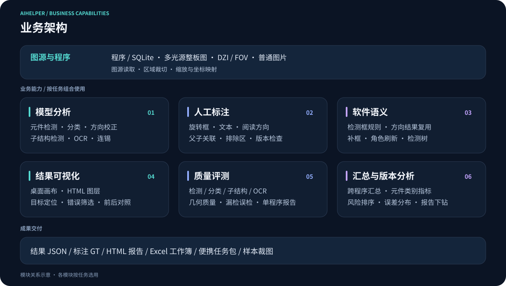
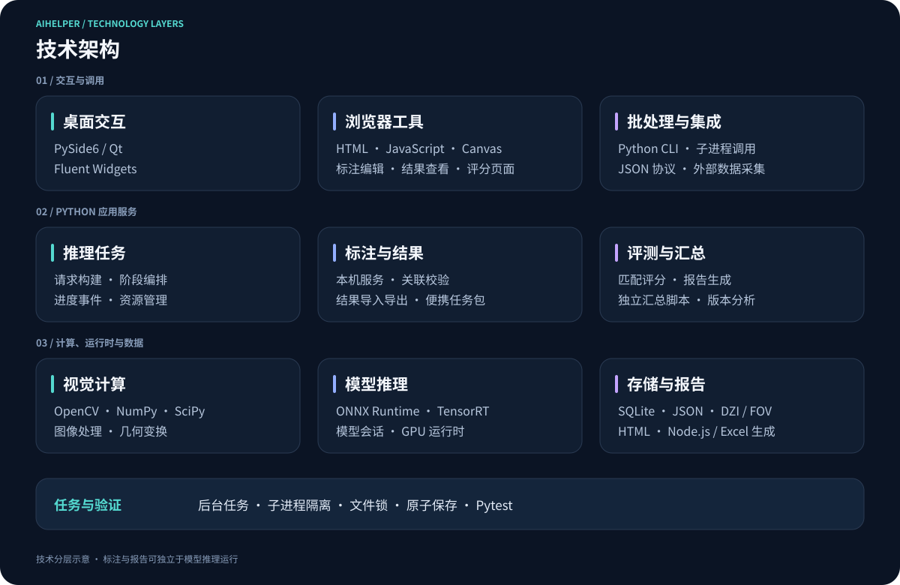

# 公开架构设计

本文只描述可以公开的设计原则和组件关系，不包含业务源码、生产参数、模型信息或内部系统地址。

## 设计目标

AIHelper 同时服务交互式调试、批量回归、人工标注和质量分析。推理入口共享应用流水线，保证请求验证、阶段顺序、事件和失败处理有共同依据；标注服务负责 GT 编辑与保存，报告工具通过结构化结果和评分记录连接。汇总历史评分时可以直接读取产物，无需再次推理。

## 业务模块

业务模块按任务组合使用。模型结果与人工维护的 GT 进入评测，保存的评分记录再进入程序和版本汇总；标注编辑、结果查看与历史报告汇总可以独立开展。

## 技术分层

桌面使用 PySide6 / Qt，浏览器工具使用 HTML、JavaScript 与 Canvas；Python 应用服务连接推理、标注、结果和评测。图像计算由 OpenCV、NumPy、SciPy 支持，模型运行使用 ONNX Runtime / TensorRT，报告生成覆盖 HTML 和依赖 Node.js 的 Excel 工具。

## 服务与数据关系

## 分层职责

| 层级 | 主要职责 | 边界 |
| :--- | :--- | :--- |
| Inference interface | GUI、批量任务和独立推理入口 | 使用公开请求与执行契约 |
| Application | 请求验证、阶段编排、事件、取消和失败报告 | 编排推理任务与阶段服务 |
| Vision modules | 检测、分类、方向、子结构与 OCR | 只通过明确上下文交换阶段结果 |
| Annotation | 浏览器编辑、本机服务、GT 校验、任务包 | 人工维护 GT，校验父子身份与文档版本 |
| Evaluation | 几何匹配、分任务评分、错误与单程序报告 | 评分读取 GT，不自动修改标准答案 |
| Visualization | 桌面与 HTML 查看、图层、列表联动、语义对照 | 使用一致的坐标与结果身份 |
| Aggregate reporting | 独立汇总脚本、版本驾驶舱、开发诊断、Excel | 消费已有评分记录，保留阶段与输入口径 |
| Infrastructure | 图源、程序数据、状态、锁和输出 | 隔离文件系统与运行环境细节 |

## 核心数据流

每次运行都带有独立身份，并记录其输入来源、启用阶段和模型角色。阶段之间传递结构化结果，而不是从界面临时状态推断业务数据。旋转框和子结构结果最终统一恢复到板级坐标空间，以便显示、评分和导出使用同一几何定义。

## 标注、评测与汇总的数据流

1. 推理或结果导入提供预测，人工标注服务提供独立维护的 GT。
2. 标注保存校验 Stage1、Stage2、OCR 的稳定身份与父子引用，检测 revision 冲突。
3. 评测模块读取预测和 GT，分开计算检测、分类、子结构与 OCR 指标，生成结构化评分及单程序 HTML。
4. 综合评分脚本读取已有评分记录，按程序、版本、阶段和元件类别汇总，再生成 HTML 与 Excel。
5. 汇总页通过源报告链接支持下钻；链接目标与图像资源需要保持可访问。

HTML 标注、预测查看、单程序评分和跨程序汇总有不同职责。它们通过产物契约协作，不要求每次打开报告都执行推理。便携标注包支持顺序交接，不提供多人并发合并。

## 并发模型

- 耗时图像处理和推理在后台任务中执行。
- 后台任务只发布不可变事件，不直接修改界面控件。
- 界面线程按顺序消费事件并更新状态。
- 运行状态和输出发布采用并发安全写入，避免多个入口互相覆盖。

## 失败语义

流水线把失败视为业务结果的一部分：阶段错误会终止依赖它的后续阶段，同时保留已经确认的运行身份、阶段信息和诊断报告。基线验证发现差异时同样返回失败，而不是修改标准答案使本次运行通过。

## 兼容策略

公开入口和输出结构属于稳定契约；兼容层只负责适配历史调用，不承载新的业务规则。新增推理能力扩展应用契约；标注与报告能力遵守 GT、结果和评分的数据契约。完整模块与独立脚本见[功能全景](features.md)。
